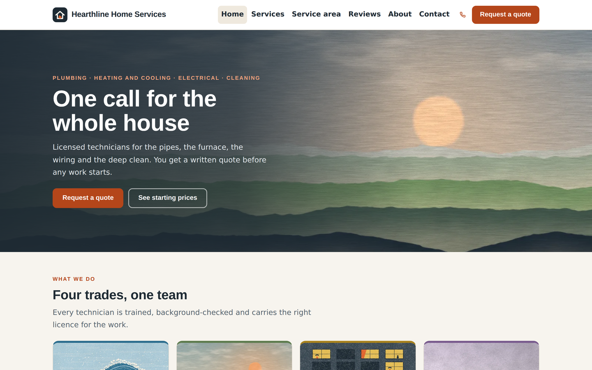
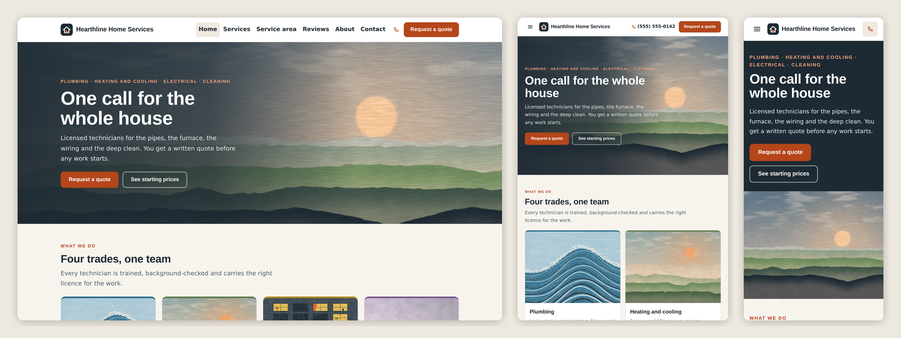

# Hearthline Home Services — SkyNet Home Services Template

A responsive website and back office for a home services business (plumbing, heating and cooling, electrical, cleaning), for **ASP.NET Core (.NET 10)**, built on the **SkyNet Framework**.

[](https://dotnet.microsoft.com/)
[](https://www.nuget.org/packages/TheSkyLite.SkyNet)



> **Sample content.** Hearthline Home Services, its services, prices, ZIP codes, technicians, address and phone number are invented placeholders. Replace them in **Settings**, **Services and prices**, **Service area**, **Technicians** and **Pages** (or in `data/site.json`). The site ships with no customers, quotes, jobs, invoices, messages or reviews. Every form saves for real: quote requests to `data/quotes.json` (photos to `images/requests/`), messages to `data/messages.json`, jobs to `data/jobs.json`, invoices to `data/invoices.json`, reviews to `data/reviews.json`.

## Features

- **26 pages:** 8 public pages (Home, Services, Service area, Request a quote, the customer's quote page, Reviews, About, Contact) and 18 staff pages.
- **Responsive:** desktop, tablet and phone layouts. Staff lists become cards on phones.
- **Services with starting prices.** Grouped by trade; the server works out the "from" price per trade.
- **ZIP code check.** The server checks the ZIP against the service area and shows the zone's trip fee (Home, Service area, quote form).
- **Request a quote.** Customers pick services, describe the job, upload up to 6 photos (JPG, PNG or WebP, 8 MB each, checked by content), and pick preferred days and times. The server validates everything and works out the running "starting from" summary.
- **Written quotes with line items.** Staff add lines, or pick them from the price list. The server works out the subtotal, the trip fee and tax (one rate, set in Settings). Sending creates a secret link and a ready-to-copy email.
- **Customer accepts online.** Opening the link alone is not enough: the customer types their name and the **last 4 digits of their phone number**. Wrong digits are refused, and the page pauses after 5 wrong tries. Quotes expire after the validity period in Settings. Staff can also record an acceptance taken by phone.
- **Jobs.** Jobs are booked from accepted quotes. The server refuses a technician who does not work that weekday, does not do that trade, or already has a job in that window. Statuses run scheduled → on the way → in progress → done. "On the way" and "In progress" are only possible on the job's own day. Stepping a job back is a separate right.
- **Dispatch board.** A day view with one column per technician, rows by two-hour window and an unassigned lane. Staff click a job to assign it or move it. On phones it stacks per technician.
- **Invoices.** A finished job becomes a draft invoice copied from the accepted quote. Issuing gives it the next number (`HL-2026-0001`). Staff mark it paid by card, cash or check (a check number is required); there is no online payment. Invoices can be voided or printed.
- **Customers.** Grouped by email or phone, with a timeline of quotes, jobs and invoices, the amount paid and the amount owed.
- **Reviews, honestly.** Staff write a review up from real customer feedback. Saving requires a "this is real feedback the customer agreed to publish" confirmation. Only published reviews appear, and the public page explains this. The site ships with none.
- **Pages editor.** Every public page is a list of blocks: page top, text, picture and text, cards, steps, numbers, checklists, people, questions, quote, picture or video, and call to action. The editor supports drag to reorder, hide and versions with Restore. Data parts (ZIP check, service list, forms) can be moved and retitled but not removed.
- **Media library.** Upload photos and MP4 videos, edit alt text, and delete only files that nothing uses. A shared picker is used for page blocks, trade pictures and technician photos.
- **Staff accounts with View / Edit / Extra rights per area**, an activity log of every change and every refused request, and a Demo and Production run mode.
- **No front-end build:** plain HTML, CSS and vanilla JavaScript.



## Getting started

Requirements: .NET 10 SDK.

    cd HomeServices
    dotnet run

The SkyNet package (`TheSkyLite.SkyNet`) restores from NuGet. The app opens on **Home** at http://localhost:5243. The staff area is at **/AdminLogin**; there is also a "Staff sign in" link in the footer.

## Permissions

Each person gets None, View, Edit or Edit + Extra per area. Managers have every right.

| Area | Rights | Extra right |
|---|---|---|
| Quotes | View, Edit | Send quotes, withdraw them, record an acceptance by phone |
| Jobs | View, Edit (own jobs only for technicians) | Step a job back a status |
| Dispatch board | View, Edit (assign and move) (own column only for technicians) | |
| Invoices | View, Edit (create, issue, discard drafts) | Mark paid, void |
| Customers | View | |
| Technicians | View, Edit | |
| Services and prices | View, Edit | |
| Service area | View, Edit | |
| Reviews | View, Edit (write up) | Publish, unpublish, delete |
| Pages | View, Edit | |
| Media library | View, Edit (upload, alt text) | Delete files |
| Messages | View, Edit (mark done) | Delete |
| Activity log | View (without it: "My activity") | |
| Users and rights, Settings | managers only | |

**Technician logins:** link the account to a technician record and tick **Own jobs only**. Jobs, the dispatch board and the dashboard then show only that technician's jobs. They can move their jobs along and add notes, but cannot reassign, reschedule or cancel. The Users page has quick-start presets (Technician, Office, Bookkeeper, Website editor).

## Run mode

`appConfig/application.cfg` has `app.app.runmode`:

- **0 Demo** (as shipped): the staff sign-in is filled in (`demo` / `demo1234`), and any user name and password signs in as a demo manager with every right.
- **1 Production:** staff sign in with their own accounts. Set this before you go live; it also ends every demo session at once.

## First sign-in (Production)

1. Set `app.app.runmode | 1`, run the site on your computer and open **/AdminLogin**. The page shows the first user name (`admin`) and a password made just for this site. It is shown only on the computer the site runs on, and is also in `appConfig/initial-admin.txt`.
2. Sign in and choose your own password (8 characters or more). The box and the file disappear.
3. Open **Users and rights** and add an account for each person. Each one gets a temporary password and chooses their own at their first sign-in.

Forgot the first password before using it? Delete `appConfig/initial-admin.txt` and open the sign-in page again. Locked out of every manager account? Remove the managers from `data/staff.json` and open the sign-in page.

## Deploying

1. Publish with the `web.config` from the project (IIS). Give the application pool Modify on `data/`, `temp/` and `appConfig/`, and on `images/uploads/` and `images/requests/` (create both first). Use HTTPS.
2. If nobody has signed in yet, read the first password from `appConfig/initial-admin.txt` on the server.
3. Check that `/data/staff.json` and `/appConfig/initial-admin.txt` answer 404 in a browser.
4. Customer quote links are built from the address staff use for the admin, so open the admin through the public https address.

> **Redeploying:** publishing copies `data/` over the live files. Download the live `data/` folder first or leave it out of the publish.

## Project structure

```
HomeServices/
├── appConfig/application.cfg     settings and run mode (placeholder secrets)
├── codes/                        26 page classes
│   ├── Core/                     Store, Access, Auth, Local, Ui, Work, Media, Blocks
│   └── Models/HomeServicesModel.cs
├── htmls/  scripts/  styles/     one file per page
├── data/site.json                business details, trades, services, zones, ZIPs, technicians, pages
├── data/media.json               the media library
├── images/                       13 artworks painted in code (WebP) and their thumbnails
├── Program.cs  web.config  HomeServices.csproj  LICENSE
```

### One page = four files, one name

| File | Holds |
|---|---|
| `codes/[Page].cs` | the page class and its server methods |
| `htmls/[Page].html` | markup with `{plhd_*}` placeholders |
| `scripts/[Page].js` | one IIFE namespace, `[Page]Js` |
| `styles/[Page].css` | styles, every class prefixed (`hm-`, `qt-`, `aq-`, ...) |

## SkyNet in action

The ZIP check on the Home page:

```javascript
function zip() {
    call('CheckZip', [{ key: 'zipcode', vlu: val('hm-zipin') }]);
    return false;
}
```

```csharp
public async Task<ApiResponse> CheckZip()
{
    ApiResponse response = new ApiResponse();
    string zip = Ui.Clip(GetDataValue("zipcode"), 10);
    SiteData site = await Store.LoadSite();
    ZipArea? z = site.Zips.FirstOrDefault(x => x.Zip == zip);
    response.SetElementContents("hm-zipr", z == null ? "..." : "Yes, we come to " + Ui.Esc(z.Town) + "...");
    return response;
}
```

| Page | Request | Response |
|---|---|---|
| Quote | `Submit` | field errors, or the confirmation with the Q- reference |
| QuoteView | `Accept` | checks the link, expiry and last 4 phone digits, then shows "Quote accepted" |
| AdminQuotes | `Calc` / `Save` | server totals; draft saved or quote sent with link and email text |
| AdminJobs | `Book` / `Move` | job booked (or the technician refused); status moved per the clock rules |
| AdminInvoices | `Save` / `Pay` | invoice issued with the next number; marked paid by card, cash or check |
| AdminPages | `Save` / `Restore` | blocks checked and saved; earlier version restored |

## Customize it

- **Content:** use the staff pages (Settings, Pages, Services and prices, Service area, Technicians, Media library), or edit `data/site.json`.
- **Brand colors and fonts:** the `--xx-*` tokens at the top of each `styles/*.css` (ink `#1E2A33`, background `#F7F4EE`, accent `#E2622B`; fonts Archivo and Source Sans 3). Trade colors are set per trade in Services and prices.

## License

- **This template** (all source files, artwork and data in this repository): [MIT License](LICENSE) — free to use, modify and redistribute, including commercially.
- **SkyNet Framework** (`TheSkyLite.SkyNet` NuGet package): proprietary, free to use for eligible users including commercial use; see the license included in the package.

Both parts are in the `LICENSE` file at the project root.
